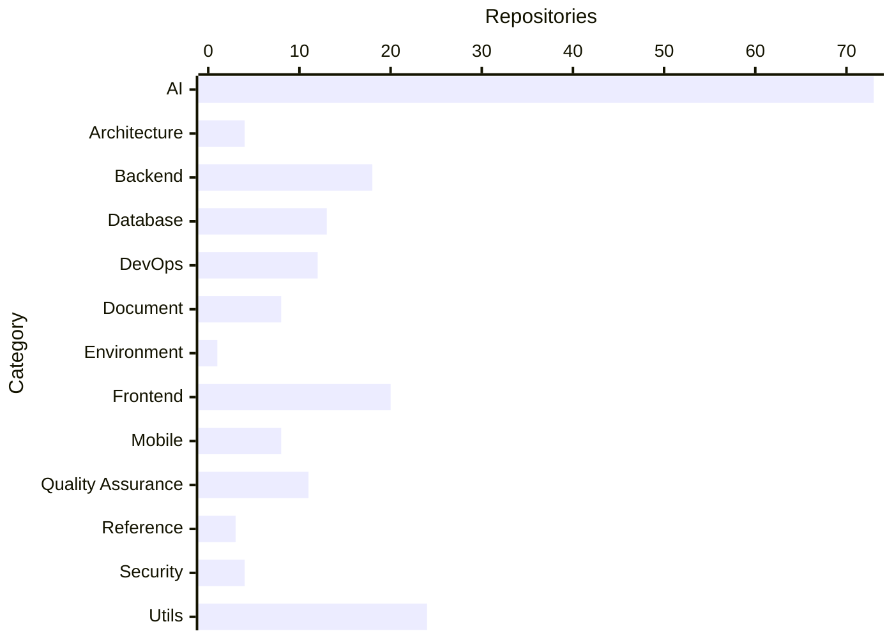

# Resource

My tools that I use and research.

A curated catalog of useful tools and open source projects. Each entry lives in its own Markdown file under [`tools/`](tools/), so the list can grow without a database.

## Overview

The chart shows the number of projects in each category. Star badges are live; GitHub Actions fetches numeric counts daily and sorts entries by stars within each category.



## Categories

[AI](#ai) | [Architecture](#architecture) | [Backend](#backend) | [Database](#database) | [DevOps](#devops) | [Document](#document) | [Environment](#environment) | [Frontend](#frontend) | [Mobile](#mobile) | [Quality Assurance](#quality-assurance) | [Reference](#reference) | [Security](#security) | [Utils](#utils)

<a id="ai"></a>
<details open>
<summary>AI (73)</summary>

#### Agent

- [Sim](https://github.com/simstudioai/sim) —   ⭐ 30,200
- [Mastra](https://github.com/mastra-ai/mastra) —   ⭐ 29,810
- [AI SDK](https://github.com/vercel/ai) —   ⭐ 28,193
- [LangChainJS](https://github.com/langchain-ai/langchainjs) —   ⭐ 18,366
- [Voltagent](https://github.com/voltagent/voltagent) —   ⭐ 11,009
- [Flue](https://github.com/withastro/flue) —   ⭐ 8,702
- [Swarmclaw](https://github.com/swarmclawai/swarmclaw) —   ⭐ 713
- [NodeTool](https://github.com/nodetool-ai/nodetool) —   ⭐ 657 — Create Workspace
- [SlopCamera](https://github.com/hraness/slopcamera) —   ⭐ 7 — Make images, diagrams, animation, 3D scenes and Video (archived - no longer maintained)
- [Code Motion](https://github.com/bytepatterns/code-motion) —   ⭐ 0 — Algorithm explainer reels drawn entirely in code

#### Coding

- [Spec Kit](https://github.com/github/spec-kit) —   ⭐ 151,338 — Toolkit to help you get started with SDD
- [Orca](https://github.com/stablyai/orca) —   ⭐ 137,124
- [t3code](https://github.com/pingdotgg/t3code) —   ⭐ 78,652
- [OpenSpec](https://github.com/Fission-AI/OpenSpec) —   ⭐ 75,692 — Spec-driven development (SDD)
- [BMAD-METHOD](https://github.com/bmad-code-org/BMAD-METHOD) —   ⭐ 55,722 — Breakthrough Method for Agile AI-Driven Development
- [Paseo](https://github.com/getpaseo/paseo) —   ⭐ 25,236 — Orchestrate multiple coding agents
- [Paradev](https://github.com/ParadevAI/Paradev) —   ⭐ 16,628
- [freebuff](https://github.com/CodebuffAI/freebuff) —   ⭐ 14,301
- [OpenChamber](https://github.com/openchamber/openchamber) —   ⭐ 13,249
- [OpenGSD](https://github.com/open-gsd/gsd-core) —   ⭐ 11,834 — Git. Ship. Done (SDD)
- [Kiro](https://github.com/kirodotdev/Kiro) —   ⭐ 4,495 — Kiro is an agentic IDE
- [Optio](https://github.com/jonwiggins/optio) —   ⭐ 1,116
- [h5i](https://github.com/h5i-dev/h5i) —   ⭐ 1,003 — Axum-based Rust web framework with Lean 4-verifiable application kernels that run on servers, bare-metal embedded devices, and GPUs, plus integrated security testing
- [Awesome Spec-Driven Development](https://github.com/Engineering4AI/awesome-spec-driven-development) —   ⭐ 331 — Curated list of awesome resources for spec-driven development (SDD)
- [Opencastle](https://github.com/monkilabs/opencastle) —   ⭐ 81
- [Lastlight](https://github.com/nearform/lastlight) —   ⭐ 48 — AI Software Factory

#### Education

- [OpenMAIC](https://github.com/THU-MAIC/OpenMAIC) —   ⭐ 44,411 — Open Multi-Agent Interactive Classroom for an immersive, multi-agent learning experience in one click
- [Human Skill Tree](https://github.com/24kchengYe/human-skill-tree) —   ⭐ 603 — AI-powered skill tree for lifelong learning with 30+ skills from K-12 to career and social intelligence, built on cognitive science
- [Whiteboard AI Tutor](https://github.com/molly554/whiteboard-ai-tutor) —   ⭐ 567 — Open-source whiteboard AI tutor with animated lessons and interactive playback, comparing Claude, Gemini, and DeepSeek across 288 generation runs and 64 blind-reviewed boards
- [Teacher to Skills](https://github.com/JuneYaooo/teacher-to-skills) —   ⭐ 490 — Distill your teacher into a source-backed Skill that teaches you until you can work on your own
- [Ari](https://github.com/nichochar/ari) —   ⭐ 378 — Local-first AI tutor for learning with pen, paper, and AI
- [BloomTutor](https://github.com/Li-Evan/BloomTutor) —   ⭐ 334 — Open-source AI tutor for personalized learning with Socratic, adaptive lessons, available as a Claude Code skill and a self-hosted web app
- [OpenTutor](https://github.com/zijinz456/OpenTutor) —   ⭐ 192 — Local-first, self-hosted adaptive learning workspace that turns uploaded material into AI-generated notes, quizzes, flashcards, and an adaptive tutor, with 10+ LLM providers
- [Mentingo](https://github.com/Selleo/mentingo) —   ⭐ 112 — Open-source AI-native LMS with AI Mentor and role-play, a self-hosted alternative to Moodle, Docebo, TalentLMS, Thinkific, Teachable, and Open edX
- [Aula](https://github.com/luumlabs/aula) —   ⭐ 74 — Free, open-source AI tutor and study app that turns notes, slides, and past exams into lessons, quizzes, flashcards, and mock exams, working with ChatGPT, Claude, or a local LLM
- [WenFlow](https://github.com/wenflow-org/wenflow) —   ⭐ 72 — Self-hosted, early-stage AI learning path prototype that clarifies goals through dialogue, generates executable learning paths, and schedules forgetting-curve reviews (Vue 3, Node.js, SQLite)
- [Sprigo](https://github.com/ozerozdas/sprigo) —   ⭐ 30 — Local-first desktop language-learning app with lessons, stories, and conversation practice generated by an AI model running on your own machine
- [Codemm](https://github.com/iignaite/Codemm) —   ⭐ 21 — Desktop app for learning any language or framework step by step, with your own coding agent as the tutor
- [SpeakGenie AI Tutor](https://github.com/CipherCraze/SpeakGenie-AI-Tutor) —   ⭐ 18 — AI-powered English learning platform with voice interaction, roleplay scenarios, and multi-language support (React, TypeScript, Convex, Google Generative AI)
- [Masar X](https://github.com/Masar-X/Masar-x) —   ⭐ 15 — Bilingual (English/Arabic) AI-powered study platform for university students with materials, quizzes, and an AI tutor (Next.js, Supabase, Electron, Expo)
- [LookatStudy](https://github.com/Kaiji-Z/LookatStudy) —   ⭐ 14 — Turns any GitHub repo into a Duolingo-style course with an AI tutor, per-concept mastery tracking (BKT), and spaced repetition, running 100% locally with your own LLM key
- [Clariqo](https://github.com/chaitanya9560/Clariqo) —   ⭐ 1 — AI study workspace built with Next.js and TypeScript: PDF chat, quizzes, flashcards, mind maps, and personalised study plans, powered by Groq and Supabase

#### Gateway

- [LiteLLM](https://github.com/BerriAI/litellm) —   ⭐ 63,875 — AI gateway and Python SDK to call 100+ LLM APIs in OpenAI format with cost tracking, guardrails, load balancing, and logging
- [Portkey AI Gateway](https://github.com/Portkey-AI/gateway) —   ⭐ 13,442 — Fast AI gateway with integrated guardrails that routes to 1600+ LLMs through a single OpenAI-compatible API
- [Bifrost](https://github.com/maximhq/bifrost) —   ⭐ 10,017 — High-performance open-source AI gateway for LLMs, MCP, and agents with an OpenAI-compatible API, failover, load balancing, semantic caching, and budgets
- [AISIX](https://github.com/api7/aisix) —   ⭐ 235 — Open-source AI gateway for LLMs and AI agents, built in Rust, with an OpenAI-compatible API, routing, guardrails, caching, rate limits, and observability
- [TheGate](https://github.com/fikalalif/thegate) —   ⭐ 1 — Control plane for AI with intelligent LLM routing, real-time cost optimization, and a virtual workforce cockpit with zero prompt persistence

#### Generative AI

- [Ollama](https://github.com/ollama/ollama) —   ⭐ 188,079
- [vLLM](https://github.com/vllm-project/vllm) —   ⭐ 97,551
- [GPT4All](https://github.com/nomic-ai/gpt4all) —   ⭐ 77,334
- [LocalAI](https://github.com/mudler/LocalAI) —   ⭐ 50,530
- [LM Studio](https://github.com/lmstudio-ai/lms) —   ⭐ 5,446

#### Harness

- [Deepseek Harness](https://github.com/deepseek-ai/deepseek-harness) —   ⭐ 286,832 — Everything is a Plugin
- [Opencode](https://github.com/anomalyco/opencode) —   ⭐ 229,078 — The open source coding agent
- [Oh My Hermes](https://github.com/rlaope/oh-my-hermes) —   ⭐ 6,036 — Operating layer for Hermes Agent that runs parallel AI coworkers, each with its own skill and model
- [Awesome Harness Engineering](https://github.com/walkinglabs/awesome-harness-engineering) —   ⭐ 4,799 — Awesome tools & guides for harness engineering
- [Opencrabs](https://github.com/opencrabs/opencrabs) —   ⭐ 1,030 — The all-in-one AI agent
- [Har](https://github.com/os-factory/har) —   ⭐ 135 — Software factory workflows 

#### Personal AI Assistant

- [OpenClaw](https://github.com/openclaw/openclaw) —   ⭐ 395,179
- [Nanobot](https://github.com/HKUDS/nanobot) —   ⭐ 50,314

#### Skill

- [skills](https://github.com/vercel-labs/skills) —   ⭐ 40,832 — CLI for the open agent skills ecosystem
- [Video Shortcraft](https://github.com/Vincentwei1021/video-shotcraft) —   ⭐ 22,519 — Cinematic product videos with Remotion
- [Software Factory](https://github.com/dzhng/skills) —   ⭐ 1,520 — AI skills for building software factories
- [Business Analysis Skills](https://github.com/45ck/business-analysis-skills) —   ⭐ 64 — Platform-neutral skill pack for business analysis, requirements discovery, elicitation, workflows, and quality checks
- [Remotion Skill](https://github.com/Westleighinauspicious5506/agent-skill-remotion-motion-graphics) —   ⭐ 2 — Build kinetic-typography and logo promos as code with Remotion
- [Agent Skills](https://github.com/Emmraan/agent-skills) —   ⭐ 1 — Collection of 180+ portable SKILL.md capability modules for AI agents
- [Requirements Elicitation Skill](https://github.com/EchoAran/requirements-elicitation-skill) —   ⭐ 0 — Stateful, adaptive requirements interviews that turn vague ideas into traceable requirement artifacts

#### UI

- [CopilotKit](https://github.com/CopilotKit/CopilotKit) —   ⭐ 38,965
- [AionUi](https://github.com/iOfficeAI/AionUi) —   ⭐ 34,496
- [AG UI](https://github.com/ag-ui-protocol/ag-ui) —   ⭐ 21,662
- [Assistant UI](https://github.com/assistant-ui/assistant-ui) —   ⭐ 13,412
- [Tambo](https://github.com/tambo-ai/tambo) —   ⭐ 11,225

#### Video

- [Kookaburra Cut](https://github.com/michael-palmes/kookaburra-cut) —   ⭐ 10 — An AI driven - Video studio

</details>

<a id="architecture"></a>
<details open>
<summary>Architecture (4)</summary>

#### Packages

- [Nix](https://github.com/NixOS/nixpkgs) —   ⭐ 26,949

#### Stack

- [Agent Native](https://github.com/BuilderIO/agent-native) —   ⭐ 7,777
- [Objectstack](https://github.com/objectstack-ai/objectstack) —   ⭐ 103
- [Better Stack](https://github.com/better-stack-ai/better-stack) —   ⭐ 81

</details>

<a id="backend"></a>
<details open>
<summary>Backend (18)</summary>

- [Laravel](https://github.com/laravel/laravel) —   ⭐ 85,429
- [Nest](https://github.com/nestjs/nest) —   ⭐ 77,161
- [Express](https://github.com/expressjs/express) —   ⭐ 69,726
- [Gatsby](https://github.com/gatsbyjs/gatsby) —   ⭐ 55,917
- [Meteor](https://github.com/meteor/meteor) —   ⭐ 44,789
- [Kong](https://github.com/Kong/kong) —   ⭐ 44,416
- [Fastify](https://github.com/fastify/fastify) —   ⭐ 37,459
- [Hono](https://github.com/honojs/hono) —   ⭐ 33,070
- [SST](https://github.com/anomalyco/sst) —   ⭐ 26,466
- [Rocket](https://github.com/rwf2/Rocket) —   ⭐ 25,812
- [Elysia](https://github.com/elysiajs/elysia) —   ⭐ 19,398
- [Redwood](https://github.com/redwoodjs/graphql) —   ⭐ 17,585
- [Feathers](https://github.com/feathersjs/feathers) —   ⭐ 15,260
- [Yii](https://github.com/yiisoft/yii2) —   ⭐ 14,278

#### E-commerce

- [Openship](https://github.com/openshiporg/openship) —   ⭐ 1,684 — Open source order router connecting sales channels to fulfillment, built on Next.js and Keystone.js

#### Headless CMS

- [Strapi](https://github.com/strapi/strapi) —   ⭐ 73,549
- [Directus](https://github.com/directus/directus) —   ⭐ 38,641

#### Lambda

- [Bref - PHP](https://github.com/brefphp/bref) —   ⭐ 3,412

</details>

<a id="database"></a>
<details open>
<summary>Database (13)</summary>

#### ORM

- [Prisma](https://github.com/prisma/orm) —   ⭐ 47,763
- [TypeORM](https://github.com/typeorm/typeorm) —   ⭐ 36,676
- [Drizzle ORM](https://github.com/drizzle-team/drizzle-orm) —   ⭐ 36,387
- [Sequelize](https://github.com/sequelize/sequelize) —   ⭐ 30,347
- [Knex](https://github.com/knex/knex) —   ⭐ 20,336
- [MikroORM](https://github.com/mikro-orm/mikro-orm) —   ⭐ 9,277
- [Objection](https://github.com/vincit/objection.js) —   ⭐ 7,335

#### Store

- [MongoDB](https://github.com/mongodb/mongo) —   ⭐ 28,709
- [TimeScale](https://github.com/timescale/timescaledb) —   ⭐ 23,896
- [Postgres](https://github.com/postgres/postgres) —   ⭐ 22,942
- [MySQL](https://github.com/mysqljs/mysql) —   ⭐ 18,611
- [SQLite](https://github.com/sqlite/sqlite) —   ⭐ 11,131
- [MariaDB](https://github.com/MariaDB/server) —   ⭐ 8,655

</details>

<a id="devops"></a>
<details open>
<summary>DevOps (12)</summary>

- [Caddy](https://github.com/caddyserver/caddy) —   ⭐ 79,520
- [PM2](https://github.com/Unitech/pm2) —   ⭐ 43,342
- [Portainer](https://github.com/portainer/portainer) —   ⭐ 38,908
- [Nginx](https://github.com/nginx/nginx) —   ⭐ 33,294
- [Vercel](https://github.com/vercel/vercel) —   ⭐ 16,662
- [Kiri](https://github.com/libracoder/kiri) —   ⭐ 13,195 — A lightweight, cross-platform Docker-compatible container runtime.
- [DDev](https://github.com/ddev/ddev) —   ⭐ 3,967
- [Piko](https://github.com/andydunstall/piko) —   ⭐ 2,205
- [Kool](https://github.com/kool-dev/kool) —   ⭐ 726

#### Developer Portal

- [Backstage](https://github.com/backstage/backstage) —   ⭐ 34,919 — Open-source framework for building developer portals with a software catalog, templates, TechDocs, and plugins.

#### Diagram

- [Homelab Diagram](https://github.com/Goblinmine/homelab-diagram) —   ⭐ 1,804 — Renders an r/homelab-style network diagram from a YAML inventory (Python to SVG/PNG); layout is hand-placed for the author's network

#### Framework

- [oclif](https://github.com/oclif/oclif) —   ⭐ 9,610 — CLI framework for generating, building, and releasing command-line tools in Node.js.

</details>

<a id="document"></a>
<details open>
<summary>Document (8)</summary>

- [Docusaurus](https://github.com/meta/docusaurus) —   ⭐ 66,794
- [Siyuan](https://github.com/siyuan-note/siyuan) —   ⭐ 47,381
- [Outline](https://github.com/outline/outline) —   ⭐ 41,377
- [Docsify](https://github.com/docsifyjs/docsify) —   ⭐ 31,607
- [Gitbook](https://github.com/GitbookIO/gitbook) —   ⭐ 29,105
- [MkDocs](https://github.com/mkdocs/mkdocs) —   ⭐ 22,569
- [mdBook](https://github.com/rust-lang/mdBook) —   ⭐ 22,326 — Create modern online books from Markdown files.
- [Zensical](https://github.com/zensical/zensical) —   ⭐ 6,264 — A modern static site generator by the Material for MkDocs team

</details>

<a id="environment"></a>
<details open>
<summary>Environment (1)</summary>

#### Python

- [UV](https://github.com/astral-sh/uv) —   ⭐ 92,639

</details>

<a id="frontend"></a>
<details open>
<summary>Frontend (20)</summary>

#### UI

- [React](https://github.com/react/react) —   ⭐ 252,922
- [Vue](https://github.com/vuejs/vue) —   ⭐ 212,550
- [Bootstrap](https://github.com/twbs/bootstrap) —   ⭐ 175,133
- [Next](https://github.com/vercel/next.js) —   ⭐ 143,711
- [Shadcn](https://github.com/shadcn-ui/ui) —   ⭐ 129,046
- [Ant Design](https://github.com/ant-design/ant-design) —   ⭐ 100,373
- [Tailwind](https://github.com/tailwindlabs/tailwindcss) —   ⭐ 98,810
- [Bulma](https://github.com/jgthms/bulma) —   ⭐ 50,032
- [daisyUI](https://github.com/saadeghi/daisyui) —   ⭐ 42,993
- [Tabler](https://github.com/tabler/tabler) —   ⭐ 42,131
- [Styled Components](https://github.com/styled-components/styled-components) —   ⭐ 41,049
- [Chakra UI](https://github.com/chakra-ui/chakra-ui) —   ⭐ 40,748
- [Refine](https://github.com/refinedev/refine) —   ⭐ 36,077
- [Remix](https://github.com/remix-run/remix) —   ⭐ 33,473
- [Mantine](https://github.com/mantinedev/mantine) —   ⭐ 32,003
- [Tamagui](https://github.com/tamagui/tamagui) —   ⭐ 14,318
- [OpenTUI](https://github.com/anomalyco/opentui) —   ⭐ 13,915 — A TypeScript library for building terminal user interfaces (TUI)
- [Prime](https://github.com/primefaces/primereact) —   ⭐ 8,314
- [One](https://github.com/onejs/one) —   ⭐ 4,635
- [AffectUI](https://github.com/flohoeller/affectui) —   ⭐ 962

</details>

<a id="mobile"></a>
<details open>
<summary>Mobile (8)</summary>

#### Boilerplace

- [Ignite](https://github.com/infinitered/ignite) —   ⭐ 19,954

#### Boilerplate

- [React Native Boilerplate](https://github.com/wataru-maeda/react-native-boilerplate) —   ⭐ 524

#### Core

- [Flutter](https://github.com/flutter/flutter) —   ⭐ 181,496
- [React Native](https://github.com/react/react-native) —   ⭐ 126,998
- [Expo](https://github.com/expo/expo) —   ⭐ 53,772
- [Dioxus](https://github.com/DioxusLabs/dioxus) —   ⭐ 39,914
- [Flet](https://github.com/flet-dev/flet) —   ⭐ 17,590
- [Lynx](https://github.com/lynx-family/lynx) —   ⭐ 15,278

</details>

<a id="quality-assurance"></a>
<details open>
<summary>Quality Assurance (11)</summary>

#### Application Performance Monitoring

- [SigNoz](https://github.com/SigNoz/signoz) —   ⭐ 32,735

#### Automated Testing

- [Playwright](https://github.com/microsoft/playwright) —   ⭐ 101,037
- [Cypress](https://github.com/cypress-io/cypress) —   ⭐ 51,040
- [Sentry](https://github.com/getsentry/sentry) —   ⭐ 45,881
- [Jest](https://github.com/jestjs/jest) —   ⭐ 45,475
- [Zod](https://github.com/colinhacks/zod) —   ⭐ 44,412

#### Load Testing

- [K6](https://github.com/grafana/k6) —   ⭐ 32,402
- [Locust](https://github.com/locustio/locust) —   ⭐ 28,311
- [JMeter](https://github.com/apache/jmeter) —   ⭐ 9,613
- [Gatling](https://github.com/gatling/gatling) —   ⭐ 6,966
- [Taurus](https://github.com/Blazemeter/taurus) —   ⭐ 2,118

</details>

<a id="reference"></a>
<details open>
<summary>Reference (3)</summary>

- [My Diary with OSX](https://github.com/prawee/my-daily-tools-osx) —   ⭐ 5
- [My Diary with Window](https://github.com/prawee/my-daily-tools-win) —   ⭐ 0

#### Research Papers

- [Awesome AI-Era Edu](https://github.com/THU-MAIC/Awesome-AI-Era-Edu) —   ⭐ 94 — Curated collection of papers on AI in education, covering AI applications, theoretical research, and practical exploration

</details>

<a id="security"></a>
<details open>
<summary>Security (4)</summary>

#### Access Proxy

- [Pomerium](https://github.com/pomerium/pomerium) —   ⭐ 5,118 — Identity and context-aware access proxy for zero-trust access to internal apps and services

#### Password Manager

- [Vaultwarden](https://github.com/dani-garcia/vaultwarden) —   ⭐ 71,320
- [Passbolt](https://github.com/passbolt/passbolt_api) —   ⭐ 6,247

#### Static Application Security Testing (SAST)

- [Semgrep](https://github.com/semgrep/semgrep) —   ⭐ 17,934

</details>

<a id="utils"></a>
<details open>
<summary>Utils (24)</summary>

- [n8n](https://github.com/n8n-io/n8n) —   ⭐ 212,087
- [Oh My Zsh](https://github.com/ohmyzsh/ohmyzsh) —   ⭐ 190,861
- [Free for Dev](https://github.com/ripienaar/free-for-dev) —   ⭐ 143,614
- [Excalidraw](https://github.com/excalidraw/excalidraw) —   ⭐ 136,281
- [Three](https://github.com/mrdoob/three.js) —   ⭐ 119,345
- [Storybook](https://github.com/storybookjs/storybook) —   ⭐ 91,719
- [Remotion](https://github.com/remotion-dev/remotion) —   ⭐ 75,602
- [Anime](https://github.com/juliangarnier/anime) —   ⭐ 75,052
- [Reveal](https://github.com/hakimel/reveal.js) —   ⭐ 72,627
- [Typst](https://github.com/typst/typst) —   ⭐ 57,414
- [Slidev](https://github.com/slidevjs/slidev) —   ⭐ 49,630
- [Dayjs](https://github.com/iamkun/dayjs) —   ⭐ 48,642
- [Moment](https://github.com/moment/moment) —   ⭐ 47,869
- [React Flow](https://github.com/xyflow/xyflow) —   ⭐ 39,145
- [Shields](https://github.com/badges/shields) —   ⭐ 27,431
- [PptxGenJS](https://github.com/gitbrent/PptxGenJS) —   ⭐ 6,412
- [MailTrap](https://github.com/mailtrap/mailtrap-nodejs) —   ⭐ 120

#### Motion

- [Motion](https://github.com/motiondivision/motion) —   ⭐ 35,544 — Animation library for React
- [TiXL](https://github.com/tixl3d/tixl) —   ⭐ 5,200 — create realtime motion graphics.
- [Rendiv](https://github.com/thecodacus/rendiv) —   ⭐ 170 — Editor built for AI #typescript
- [VOS](https://github.com/vosjs/vos) —   ⭐ 8 — Programmatic video engine

#### Point of Sale

- [FloCafe](https://github.com/FreeOpenSourcePOS/FloCafe) —   ⭐ 203 — Free, open-source, offline-first Point of Sale for cafes, restaurants, and food businesses

#### Video

- [Hyperframes](https://github.com/heygen-com/hyperframes) —   ⭐ 89,854 — Open-source AI video editor and HTML-to-video rendering framework

#### Visual

- [Effect](https://github.com/Effect-TS/effect) —   ⭐ 17,679

</details>

## Add a tool with Copilot

Use the `add-tool-to-catalog` skill in Copilot Chat. Paste a GitHub repository URL and ask, for example: `Use the add-tool-to-catalog skill to add https://github.com/owner/repo.` It checks for duplicates, selects a category and subcategory, creates the tool record, and validates it.

See the [skill instructions](.github/skills/add-tool-to-catalog/SKILL.md).

## Add a tool

Create a Markdown file in `tools/` with this front matter, then run `python3 scripts/build_readme.py`:

```markdown
---
name: "Example Tool"
category: "Developer Tools"
subcategory: "Optional group"
repository: "owner/repository"
description: "Optional short description"
---

Notes about the tool can go here.
```

GitHub stars are refreshed automatically every day by GitHub Actions. To refresh and sort locally, set `GITHUB_TOKEN` and run `python3 scripts/build_readme.py`.
